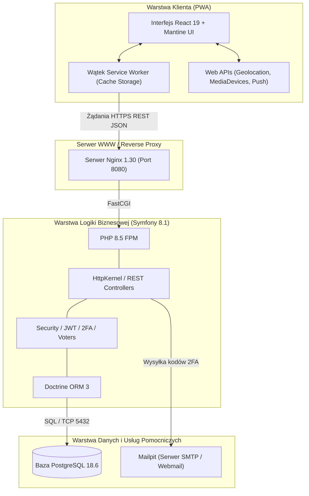
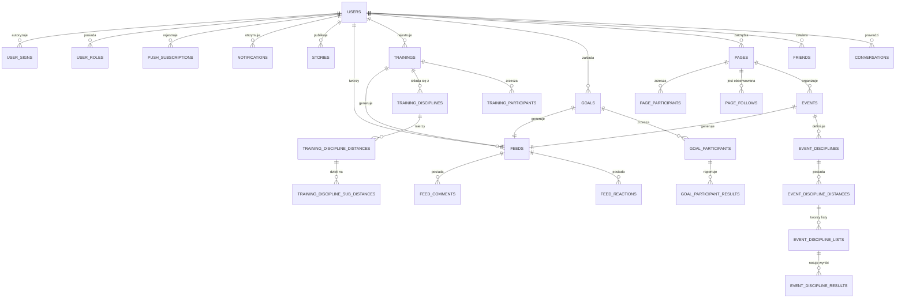

# 4. Projekt systemu wspomagającego aktywność fizyczną

Projekt systemu Sportgram powstał w celu stworzenia zintegrowanej, wieloplatformowej platformy łączącej funkcjonalności precyzyjnego rejestratora aktywności fizycznej z interaktywną warstwą społecznościową. W niniejszym rozdziale przedstawiono specyfikację wymagań inżynierskich, architekturę logiczną i fizyczną aplikacji, szczegółowy model relacyjnej bazy danych oraz koncepcję ergonomii interfejsu użytkownika.

---

## 4.1. Założenia funkcjonalne i niefunkcjonalne systemu

Wymagania inżynierskie zostały zdefiniowane w oparciu o analizę rynku aplikacji sportowych (np. Strava, Garmin Connect) oraz wytyczne międzynarodowego standardu jakości oprogramowania **ISO/IEC 25010**.

### Wymagania funkcjonalne (metoda MoSCoW)

Wymagania funkcjonalne podzielono według priorytetyzacji MoSCoW (*Must have, Should have, Could have, Won't have*):

#### Kategoria Must Have (krytyczne dla funkcjonowania systemu):
1. **Moduł rejestracji i uwierzytelniania użytkowników**:
   - Rejestracja nowego konta z walidacją adresu e-mail i numeru telefonu.
   - Dwuetapowa weryfikacja tożsamości (2FA) przy logowaniu i rejestracji za pomocą jednorazowych kodów wysyłanych pocztą elektroniczną.
   - Bezpieczne logowanie z generowaniem tokenów JWT oraz mechanizm bezpiecznego resetu hasła.
2. **Moduł treningowy (Training Tracking)**:
   - Tworzenie i ewidencjonowanie treningów w zróżnicowanych dyscyplinach sportowych (bieganie, kolarstwo, pływanie itp.).
   - Rejestracja parametrów czasowych, dystansu oraz szczegółowych międzyczasów (sub-dystansów).
   - Zapisywanie współrzędnych przestrzennych (szerokość, długość geograficzna, wysokość, dokładność, prędkość).
3. **Moduł społecznościowy (Feed i Relacje)**:
   - Publikacja wpisów tekstowych i graficznych na tablicy głównej powiązanych z aktywnościami sportowymi.
   - Dodawanie reakcji (polubień) oraz komentarzy pod wpisami.
   - Publikacja krótkotrwałych relacji multimedialnych (Stories) ze zdjęciami z kamery lub dysku.
4. **Instalowalność i obsługa PWA**:
   - Obecność manifestu `manifest.webmanifest` umożliwiającego instalację na pulpicie smartfona.
   - Podstawowa obsługa trybu offline zapewniana przez wątek Service Worker.

#### Kategoria Should Have (istotne o wysokiej wartości biznesowej):
1. **Moduł celów i grywalizacji (Goals)**:
   - Definiowanie celów indywidualnych oraz grupowych (dystansowych i czasowych).
   - Ewidencjonowanie wyników uczestników przypisanych do określonego celu.
2. **Moduł organizacji wydarzeń (Events & Pages)**:
   - Tworzenie stron zrzeszających społeczność i kluby sportowe.
   - Organizacja wydarzeń sportowych (zawodów, wspólnych biegów) z podziałem na dyscypliny i dystanse.
   - Rejestracja uczestników na dystanse oraz wprowadzanie oficjalnych wyników.
3. **Komunikacja bezpośrednia**:
   - Prowadzenie konwersacji prywatnych w czasie rzeczywistym między znajomymi wraz ze wskaźnikiem aktywności pisania.

#### Kategoria Could Have (pożądane rozszerzenia):
1. **Powiadomienia Web Push z protokołem VAPID**:
   - Informowanie użytkownika o nowych zaproszeniach do znajomych, reakcjach, komentarzach i nadchodzących wydarzeniach.
2. **Moduł zaawansowanych statystyk**:
   - Wyświetlanie rekordów osobistych oraz dynamiczne agregowanie postępów tygodniowych i miesięcznych.

---

### Wymagania niefunkcjonalne (zgodnie z ISO/IEC 25010)

1. **Wydajność i efektywność czasowa (Performance Efficiency)**:
   - Czas ładowania powłoki aplikacji (First Contentful Paint – FCP) nie może przekraczać 1,5 sekundy w sieci 4G/LTE.
   - Czas odpowiedzi serwera REST API (Time to First Byte – TTFB) dla zapytań odczytu nie powinien przekraczać 200 ms przy normalnym obciążeniu.
   - Płynność renderowania interfejsu na poziomie 60 klatek na sekundę (brak zacięć podczas przewijania list i animacji modali).
2. **Niezawodność i odporność na awarie (Reliability)**:
   - Aplikacja musi uruchamiać się i wyświetlać powłokę interfejsu oraz zbuforowane dane nawet w warunkach całkowitego braku dostępu do sieci internetowej (offline-first).
3. **Bezpieczeństwo (Security)**:
   - Wszystkie kanały komunikacyjne zabezpieczone protokołem TLS/HTTPS.
   - Hasła użytkowników hashowane z wykorzystaniem algorytmu Argon2id lub Bcrypt.
   - Dostęp do zasobów autoryzowany bezstanowym tokenem JWT z krótkim czasem życia oraz weryfikowany regułami Security Voters (kontrola uprawnień właścicielskich).
4. **Użyteczność (Usability)**:
   - Pełna responsywność interfejsu (Responsive Web Design – RWD) dostosowana do ekranów smartfonów (od 360 px szerokości), tabletów oraz monitorów desktopowych.
   - Wsparcie dla wielojęzyczności (język polski oraz angielski).
5. **Przenośność (Portability)**:
   - Spójne działanie na platformach Android (Chrome, Edge), iOS (Safari), macOS, Windows i Linux bez konieczności modyfikacji kodu źródłowego.

---

## 4.2. Architektura aplikacji (frontend-backend)

System Sportgram zaprojektowano w trójwarstwowej architekturze rozproszonej, w której każda warstwa jest ściśle odseparowana i uruchamiana w dedykowanym kontenerze środowiska **Docker** (zarządzanym przez Docker Compose).



Wyróżnia się następujące kontenery systemowe:
1. **sportgram_nginx**: Serwer Nginx 1.30 pełniący rolę reverse proxy, obsługujący połączenia HTTP/HTTPS, kompresję gzip, nagłówki bezpieczeństwa CORS oraz kierujący ruch dynamiczny do interpretera PHP-FPM przez protokół FastCGI.
2. **sportgram_php**: Środowisko wykonawcze PHP 8.5 FPM z zainstalowanymi rozszerzeniami `pdo_pgsql`, `intl`, `sodium`, `opcache`. Zawiera pełną logikę biznesową backendu Symfony.
3. **sportgram_postgres**: Relacyjna baza danych PostgreSQL 18.6 przechowująca trwale stan systemu na wolumenie dyskowym.
4. **sportgram_mailpit**: Narzędzie testowe do przechwytywania wychodzącej poczty elektronicznej (np. kodów logowania dwuetapowego i resetowania hasła) z interfejsem webowym dostępnym pod portem 8025.

---

## 4.3. Projekt bazy danych

Model relacyjnej bazy danych został zaprojektowany z zachowaniem trzeciej postaci normalnej (3NF) w celu eliminacji redundancji danych oraz zapewnienia spójności logicznej. Poniższy diagram encji (ERD) prezentuje kluczowe tabele oraz relacje zachodzące w systemie Sportgram:



### Specyfikacja kluczowych tabel systemu

#### 1. Tabela `users`
Przechowuje dane kont użytkowników oraz ich preferencje personalizacyjne.
- `id` (UUID, PK) – unikalny identyfikator użytkownika.
- `first_name`, `last_name` (TEXT) – imię i nazwisko.
- `email` (TEXT, UNIQUE) – adres poczty elektronicznej (login).
- `phone` (INT, UNIQUE) – numer telefonu komórkowego.
- `password` (TEXT) – skrót hasła (hash Bcrypt/Argon2id).
- `link` (TEXT, UNIQUE) – przyjazny identyfikator profilowy (slug URL).
- `profile_photo`, `background_photo` (BYTEA) – dane binarne awatara i tła profilowego.
- `language`, `country`, `theme`, `color` (INT) – identyfikatory preferencji językowych, motywu wizualnego oraz palety barw.
- `status` (INT) – status konta (aktywne, zablokowane, oczekujące).

#### 2. Tabele modułu telemetrycznego (`trainings`, `training_discipline_distances`, `training_discipline_sub_distances`)
Odpowiadają za hierarchiczny zapis parametrów treningowych:
- `trainings`: `id` (UUID, PK), `user_id` (FK -> users), `feed_id` (FK -> feeds), `title`, `description`, `link`, `location`, `started_at`, `ended_at`, `status`.
- `training_disciplines`: `id` (UUID, PK), `training_id` (FK -> trainings), `discipline` (INT – identyfikator dyscypliny np. bieganie, kolarstwo).
- `training_discipline_distances`: `id` (UUID, PK), `training_discipline_id` (FK), `distance` (INT – pokonany odcinek w metrach), `time` (INT – czas trwania odcinka w sekundach).
- `training_discipline_sub_distances`: `id` (UUID, PK), `training_discipline_distance_id` (FK), `sub_distance` (INT), `time` (INT), `lat` (INT – szerokość geograficzna przeskalowana), `lng` (INT – długość geograficzna przeskalowana), `accuracy` (INT – błąd w centymetrach/metrach), `speed` (INT – prędkość chwilowa).

#### 3. Tabele społecznościowe (`feeds`, `feed_comments`, `feed_reactions`, `stories`)
- `feeds`: centralny węzeł aktywności, powiązany z treningami, wydarzeniami lub celami; zawiera treść (`text`), opcjonalne zdjęcie (`photo` BYTEA) oraz referencję do autora (`user_id`).
- `feed_comments`: komentarze dyskusyjne przypisane do konkretnego wpisu.
- `feed_reactions`: polubienia i reakcje emotikonowe pod wpisem.
- `stories`: krótkoterminowe relacje graficzne o czasie widoczności 24 godzin.

#### 4. Tabele wydarzeń i stron (`pages`, `events`, `event_discipline_distances`, `event_discipline_results`)
Umożliwiają tworzenie profili instytucjonalnych i klubowych oraz organizowanie wieloetapowych imprez sportowych z rejestracją zawodników i publikacją tabel wyników.

#### 5. Tabele powiadomień i PWA (`notifications`, `push_subscriptions`)
- `notifications`: powiadomienia wewnętrzne aplikacji wyświetlane w centrum powiadomień.
- `push_subscriptions`: zapis subskrypcji Web Push zawierający klucze kryptograficzne `endpoint`, `p256dh`, `auth` oraz identyfikator przeglądarki `user_agent`.

---

## 4.4. Projekt interfejsu użytkownika

Projekt interfejsu użytkownika aplikacji Sportgram podporządkowano zasadzie **Mobile-First**, zakładając, że głównym urządzeniem wykorzystywanym podczas i po treningu jest smartfon. Jednocześnie zastosowano elastyczny system siatek (ang. *fluid grid system*) biblioteki Mantine UI, który automatycznie skaluje układ do formatu tabletów i monitorów stacjonarnych.

### Architektura informacji i nawigacja

Aplikacja składa się z 27 dedykowanych widoków (ekranów), ułożonych w spójną hierarchię:
1. **Ekran Główny (`/`)**: dynamiczny feed postów z relacjami Stories na górnym pasku, możliwość szybkiego dodania wpisu lub relacji.
2. **Moduł Autoryzacji (`/sign`, `/register`, `/password-reset`)**: zoptymalizowane, dwukrokowe formularze z asynchroniczną walidacją i weryfikacją kodu PIN.
3. **Moduł Treningów (`/users/:link/trainings`, `/trainings/:link`)**: zestawienia tabelaryczne aktywności z filtrowaniem i sortowaniem oraz szczegółowy profil treningu z wykresem tempa i trasą.
4. **Moduł Społeczności i Komunikacji (`/users`, `/users/:link/friends`, `/users/:link/conversations`)**: wyszukiwarka sportowców, czat z dymkami wiadomości oraz wskaźnikiem pisania w czasie rzeczywistym.
5. **Moduł Wydarzeń i Stron (`/events`, `/events/:link`, `/pages`, `/pages/:link`)**: katalog i tabele wyników zawodów sportowych.
6. **Moduł Statystyk i Celów (`/statistics`, `/goals/:link`)**: zestawienia rekordów życiowych, analiza sumarycznego dystansu i czasu w ujęciu periodycznym.

```
+-------------------------------------------------------------+
| [Logo Sportgram]           [Szukaj...]       [(+) Post] [Profil]
+-------------------------------------------------------------+
| Stories:  (O) Twój Story   (O) Jan Kowalski  (O) Anna Nowak |
+-------------------------------------------------------------+
| [Formularz dodawania wpisu: "Podziel się treningiem..."]     |
+-------------------------------------------------------------+
| Jan Kowalski - Poranny Bieg w Parku (Bieganie 10.42 km)     |
| Czas: 00:48:12 | Śr. tempo: 4:37 min/km                     |
| [Podgląd mapy trasy GPS]                                    |
| [Polub (14)]  [Skomentuj (3)]  [Udostępnij]                 |
+-------------------------------------------------------------+
| Anna Nowak - Osiągnięto nowy cel: 100 km w miesiącu!        |
| [Pasek postępu: 100%]                                       |
+-------------------------------------------------------------+
| [Nawigacja dolna mobilna: Home | Treningi | Wydarzenia | Czat] |
+-------------------------------------------------------------+
```

### Ergonomia obsługi na urządzeniach dotykowych
Wszystkie interaktywne elementy formularzy (przyciski, pola edycji, selektory) posiadają minimalną strefę dotyku 48x48 pikseli zgodnie z wytycznymi Google Material Design i Apple Human Interface Guidelines. Operacje edycji i usuwania zasobów umieszczono w intuicyjnych oknach modalnych z wyraźnymi komunikatami potwierdzenia, co zapobiega przypadkowej utracie danych podczas obsługi jedną ręką.
